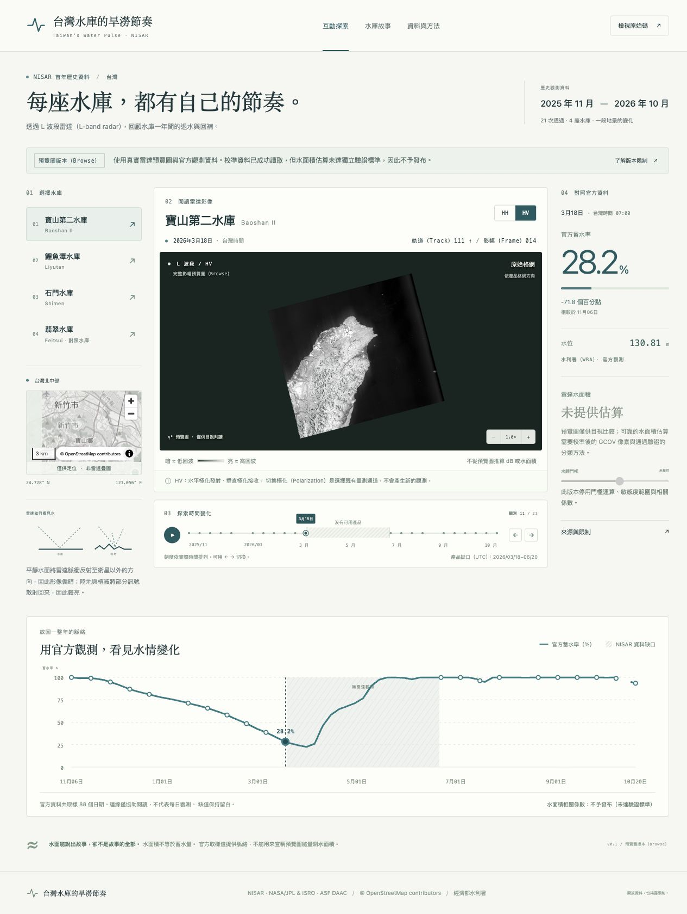

# Taiwan's Water Pulse

[繁體中文](README.md) | **English**

Explore Taiwan's reservoirs through NISAR's first year and the official gauges.

This first release is the **browse-image fallback** defined in the project brief: a historical, static experience with 21 NISAR acquisition dates, HH/HV browse images, four reservoir selections, 88 sampled official dates per reservoir, and traceable sources. Browse images support visual inspection. They are not calibrated raster values and cannot provide a water-area measurement.

**Numerical water area, a threshold overlay, sensitivity intervals and area-versus-level correlations are unavailable in this release.** Authenticated HDF5 access succeeded, but the frozen threshold methods failed independent validation on 17 held-out dates. The numerical results are therefore withheld. The interface describes this limitation instead of inventing measurements.



[Three representative screenshots](docs/submission/screenshots.md) show the local browse edition.

## Why numerical results are withheld

An authenticated read of one granule's four reservoir windows completed in 91.279 seconds without a full-file download, and the actual HDF5 projection, coordinates, fill values and mask attributes were inspected. A first HH method failed the expected full-to-dry ordering. We then froze alternative settings on four calibration dates and tested the other 17 dates without retuning:

| Reservoir | Frozen classifier | Held-out Spearman ρ against water level | Paired n | Required |
| --- | --- | ---: | ---: | ---: |
| Baoshan II | HV, unbuffered OSM polygon | 0.422 | 17 | ≥0.8 |
| Liyutan | HH, 150 m buffered polygon | 0.437 | 17 | ≥0.8 |

Both failed. The public explorer consequently shows real imagery and official gauges, with no radar area, threshold overlay, sensitivity range or correlation result. The numbers above are reproducible failed-method diagnostics, not validated water measurements. Full records and the frozen date split are in [calibration](pipeline/assets/numeric-calibration.json), [validation](pipeline/assets/numeric-validation.json) and [gate evidence](docs/gates.md).

## Run locally

Requirements: Node.js 24 LTS (`>=24.15.0`), npm 11, Python 3.14 and uv. Dependencies stay inside the project; no global package installation is required.

From the repository root:

```bash
uv sync --project pipeline --frozen
npm --prefix web ci
uv run --project pipeline water-pulse all --offline
npm --prefix web run dev -- --host 127.0.0.1
```

The main interface is in Traditional Chinese, with English technical terms where helpful.

Open the Local URL printed by Vite. Tracked public assets allow a normal demonstration without NASA or WRA runtime requests. Basemap tiles, if enabled, remain an external map dependency.

```bash
# Verify the pipeline and frontend
uv run --project pipeline pytest pipeline/tests
uv run --project pipeline ruff check pipeline
npm --prefix web test
npm --prefix web run format:check
npm --prefix web run build

# Serve the production build
npm --prefix web run preview -- --host 127.0.0.1
```

## Refresh and reproduce the assets

```bash
# Inspect the intended work without network requests or writes
uv run --project pipeline water-pulse all --dry-run

# Rebuild from tracked sources without accessing external services
uv run --project pipeline water-pulse all --offline

# Fetch the public catalog, boundaries, official data and browse images
uv run --project pipeline water-pulse all --refresh

# Scope a run to reservoirs and UTC acquisition dates
uv run --project pipeline water-pulse export --offline \
  --reservoirs baoshan2,liyutan --dates 2025-11-05,2026-03-17,2026-06-21
```

The CLI also exposes `discover`, `geometry`, `official`, `export` and `gates`. `all` builds the browse fallback; its success does not imply numerical validation. The offline numerical investigation is documented separately in the methods and its recorded reports; numerical feature code remains disabled in the released archive. See [the methods](docs/methods.md) and [gate evidence](docs/gates.md).

A scoped export replaces the exported selection; run `all --offline` again to restore the full demonstration.

To reproduce the failed numerical investigation, first provide Earthdata credentials through your local environment, then run:

```bash
uv run --project pipeline water-pulse read --reservoirs baoshan2,liyutan
uv run --project pipeline water-pulse process --reservoirs baoshan2,liyutan --offline
# Expected exit code 2: the original four-date HH direction gate fails.
uv run --project pipeline water-pulse gates --offline
# Expected exit code 2: both held-out classifiers fail the required correlation.
uv run --project pipeline water-pulse measure --reservoirs baoshan2,liyutan --offline
# Also rejects publication with exit code 2; the released archive remains browse-only.
uv run --project pipeline water-pulse export --numeric --reservoirs baoshan2,liyutan --offline
```

Raw windows and processed candidate rasters remain in ignored `data/cache/`. The CLI can read an explicit local `--credentials-file`; never commit that file. Reproducing the public browse experience requires no Earthdata account.

## What to explore

- Select Baoshan II, Liyutan, Shimen or Feitsui and inspect the official record for the same observation.
- Select a real acquisition date, play the sequence, or move with the keyboard.
- Switch HH/HV to select channels NISAR actually measured.
- Inspect the official curve, the long radar observation gap and the source details.
- Follow the five story chapters to compare the western reservoirs with Feitsui.

The official observation is at 07:00 in Taiwan. A NISAR acquisition around 21:16 UTC corresponds to about 05:16 the following Taiwan calendar day, approximately 1.7 hours before the gauge record. Missing gauge records remain missing. A line joining sampled official values is a visual guide, not a new observation.

## Publish with GitHub Pages

CI runs on pushes to `main` and pull requests. The separate **Deploy GitHub Pages** workflow builds the static frontend only when manually dispatched (`workflow_dispatch`); pushing does not automatically deploy. In repository **Settings → Pages**, choose **GitHub Actions** as the source, then run the Pages workflow from the Actions tab. The workflow uses the repository subpath for Vite's base path. Review the workflow's trigger and environment settings before enabling publication. A successful Git push alone does not establish that Pages is enabled or publicly reachable.

Expected project URL after successful deployment: [mephisto-000.github.io/taiwan-water-pulse](https://mephisto-000.github.io/taiwan-water-pulse/).

To preview the GitHub Pages subpath locally, use the same base path for both commands:

```bash
VITE_BASE_PATH=/taiwan-water-pulse/ npm --prefix web run build
VITE_BASE_PATH=/taiwan-water-pulse/ npm --prefix web run preview
```

Open `http://127.0.0.1:4173/taiwan-water-pulse/`. The normal build/preview commands above use the root path without this variable. For another host or path, configure both commands consistently as described in [dependency management](docs/dependency-management.md).

## Project structure

```text
pipeline/                 Python CLI, source snapshots and numerical unit tests
web/                      Vite + React + strict TypeScript static frontend
web/public/data/          Tracked, same-origin demonstration assets and provenance
docs/                     Methods, source attribution, gates and decisions
docs/submission/          English project-page draft and 30-second demo script
data/cache/               Ignored local downloads and working data
```

## Data and scientific limits

NASA/JPL and ISRO's NISAR mission, distributed by ASF DAAC: `NISAR_L2_GCOV_PROVISIONAL_V1`, Track 111 ascending, Frame 014, mode 4005, HH/HV, CRID P05023. Products have **Provisional** maturity and near-real-time orbit precision. Browse imagery is a visualization whose display stretch must not be treated as calibrated γ⁰ values. Zooming does not create spatial detail.

Official storage and water levels: 經濟部水利署 防災資訊服務網. The published official curves use a fresh cached response retrieved on 2026-11-14 at 11:02 Taiwan time. The supplied 25-date seed snapshot is retained separately as a fallback and integrity fixture. OpenStreetMap reservoir geometry: © OpenStreetMap contributors, ODbL. OSM water boundaries are context, not validation truth. Source URLs, retrieval details and limitations are in [data sources](docs/data-sources.md) and the exported provenance.

Wind, rainfall, floating debris, smooth exposed banks, layover, radar shadow and speckle complicate water detection. Surface area is not storage volume. The project does not infer volume or claim causal explanations from correlated observations.

## Maintain dependencies

```bash
# Review available Node updates; apply and test an intentional update
npm --prefix web outdated
npm --prefix web update
npm --prefix web test
npm --prefix web run format:check
npm --prefix web run build

# Upgrade Python locks, then restore and test
uv lock --project pipeline --upgrade
uv sync --project pipeline --frozen
uv run --project pipeline pytest pipeline/tests

# Remove an unnecessary dependency, substituting its real package name
npm --prefix web uninstall PACKAGE_NAME
uv remove --project pipeline PACKAGE_NAME
```

Commit `web/package-lock.json` and `pipeline/uv.lock` alongside manifest changes. Use `npm install --save-dev` / `uv add --dev` for development-only tools. See [dependency management](docs/dependency-management.md) for exact versions, measured installation locations, environment variables and troubleshooting.

## License and AI assistance

Project code is licensed under [MIT](LICENSE). Third-party data and libraries retain their own terms; the MIT license does not relicense them. [AI usage](docs/ai-usage.md) records generated code and text and the limits of review.
