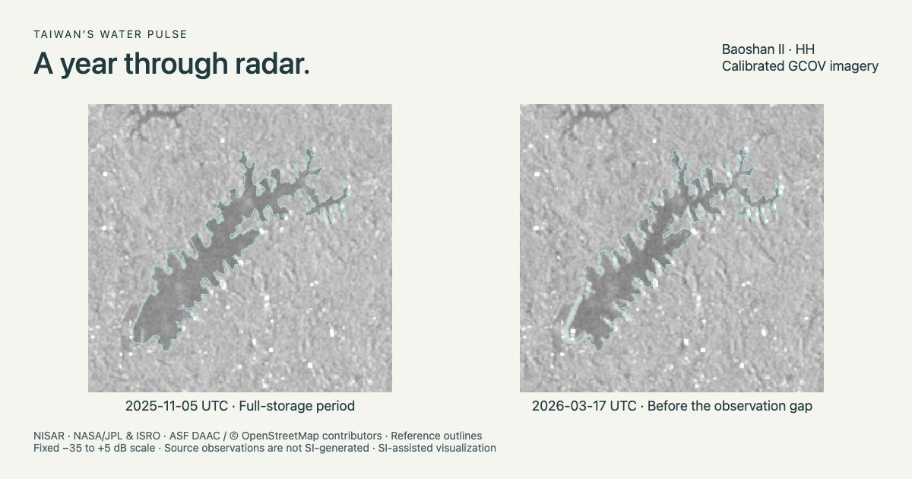

# Taiwan's Water Pulse

[繁體中文](README.md) | **English**

**Live site:** [taiwan-water-pulse.vercel.app](https://taiwan-water-pulse.vercel.app/?lang=en) · [繁體中文](https://taiwan-water-pulse.vercel.app/?lang=zh-TW) · [30-second tour](https://taiwan-water-pulse.vercel.app/?demo=1)

Explore a year of reservoir retreat and recovery using NISAR L-band radar and Taiwan Water Resources Agency observations. The interface follows the browser language, with explicit `?lang=en` and `?lang=zh-TW` options. This is a historical archive, not live monitoring.

## What changed

- Calibrated GCOV HH/HV reservoir imagery for four reservoirs and 21 acquisitions: fixed grids, north-up orientation, scale bars, OSM reference outlines and a fixed gamma-nought colour scale.
- Accessible two-date comparison, chronological filmstrips and a timeline with a visible observation gap.
- Separate radar-area and official-storage charts, scatterplots, sensitivity ranges, experimental grades and public validation reports.
- Reservoir-specific publication: unsuccessful methods retain imagery while withholding area estimates and classification overlays.
- Five chapters, an English auto-playing tour, CSV downloads, share previews, larger typography and improved contrast.
- Canvas and SVG replace MapLibre and external tiles. No new dependency was added.



## Scientific scope

The archive uses `NISAR_L2_GCOV_PROVISIONAL_V1`, ascending Track 111, Frame 014, mode 4005 and CRID P05023. Display grids and classification scales are documented separately. Pixel spacing is not effective spatial resolution.

See the [methods](docs/methods.md), [validation](docs/validation.md) and [gate evidence](docs/gates.md) for the actual thresholds, scale, correlations, bootstrap intervals, physical checks and per-reservoir decisions. Public copies of the [methods](https://taiwan-water-pulse.vercel.app/data/methods.md) and [report](https://taiwan-water-pulse.vercel.app/data/validation.json) require no repository access.

The [original held-out report](pipeline/assets/numeric-validation.json) remains available. Its four calibration dates spanned both sides of the gap; the other 17 dates were held out. The new exploratory assessment is not claimed as a fresh independent held-out test.

**Surface area is not storage volume. Correlation does not establish causation.** Official curves contain 88 sampled dates, not every day. Acquisitions near 05:16 Taiwan time are paired with the same day's 07:00 gauge observation. Missing data remain missing. This frame has no radar product from 18 March through 20 June 2026 UTC.

## Run locally

Runtime: Node.js `24.15.0`, npm `11.12.1`; Python `3.14.10`, uv `0.13.8`. Run from the repository root:

```bash
npm --prefix web ci
npm --prefix web run dev -- --host 127.0.0.1
uv sync --project pipeline --frozen
```

Published data are version-controlled. Running the website requires no Earthdata account or Vercel token. Python is needed only for pipeline work and its tests.

```bash
uv run --project pipeline pytest pipeline/tests
uv run --project pipeline ruff check pipeline
npm --prefix web test
npm --prefix web run test:deploy
npm --prefix web run format:check
npm --prefix web run build
npm --prefix web run check:deploy
npm --prefix web run preview -- --host 127.0.0.1
```

## Rebuild the archive

Raw calibrated AOI windows live in ignored `data/cache/`; they are neither committed nor deployed. Obtain them with local Earthdata credentials, then rebuild offline from a clean source commit:

```bash
uv run --project pipeline water-pulse read \
  --reservoirs baoshan2,liyutan,shimen,feitsui
uv run --project pipeline water-pulse release --offline
```

`release` is the current export entry point. The older `all --offline` and `export --offline` commands still build the Browse fallback and replace the published manifest; they do not reproduce this release. Keep credentials in environment variables or ignored local files. Review [sources](docs/data-sources.md) before refreshing external services.

## Deployment and privacy

The GitHub repository remains private. The public UI links to same-origin methods and reports. Git integration is not connected: pushing does not deploy. Checked `web/dist` artifacts are uploaded through the authenticated Vercel plugin.

No Earthdata credentials or custom environment variables are needed on Vercel. Environment files, credentials, keys, local settings and raw caches stay outside the deployment. See [deployment evidence](docs/deployment.md) for the released commit, hashes and verification.

## Dependencies

```bash
npm --prefix web outdated
npm --prefix web update
uv lock --project pipeline --upgrade
uv sync --project pipeline --frozen
npm --prefix web uninstall PACKAGE_NAME
uv remove --project pipeline PACKAGE_NAME
```

Review compatibility and security before changes, commit manifest and lock together, and repeat relevant checks. [Dependency management](docs/dependency-management.md) records measured installation locations, restore/update/removal commands and environment variables.

## SI disclosure and licensing

OpenAI Codex assisted with code, tests, copy, translation, documentation and data preparation. Visible labels and [si-usage.json](si-usage.json) disclose the scope. Scientific visualizations use actual observations; they are not generative radar images. Screenshots show the rendered application. Automated tests do not replace scientific review.

Code: [MIT](LICENSE). NISAR: NASA/JPL & ISRO, ASF DAAC. Geometry: © OpenStreetMap contributors (ODbL). Official observations: Taiwan Water Resources Agency. Source observations are not SI-generated. No agency logo or institutional endorsement is implied.
