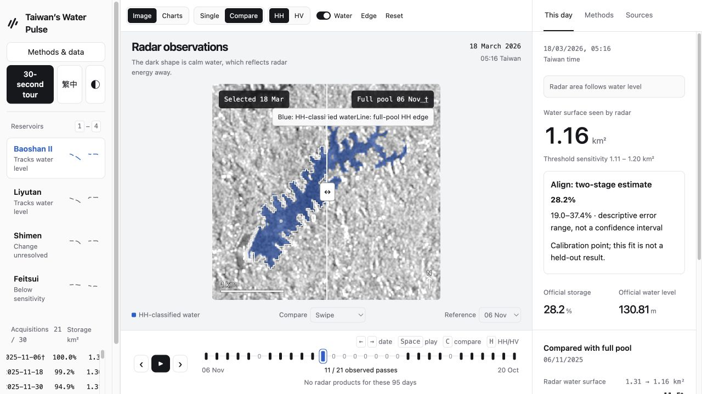

# Taiwan's Water Pulse

**English** | [繁體中文](README.zh-TW.md)

**Live site:** [taiwan-water-pulse.vercel.app](https://taiwan-water-pulse.vercel.app/?lang=en) · [繁體中文](https://taiwan-water-pulse.vercel.app/?lang=zh-TW) · [30-second tour](https://taiwan-water-pulse.vercel.app/?demo=1&lang=en)

Explore a year of reservoir retreat and recovery using NISAR L-band radar and Taiwan Water Resources Agency observations. The interface follows the browser language, with explicit `?lang=en` and `?lang=zh-TW` options. This is a historical archive, not live monitoring.

## Two-stage storage estimation (ADV-10)

**Feature commit `e33cf7a` has been merged into `main`, pushed and deployed to Vercel with status READY at 23:44:00 on 14 November 2026 (Asia/Taipei). Production verification passed for all 337 public files and the chart interactions.** In Charts, **Estimate storage from SAR** now uses two stages: area within the full-pool variation range produces only **High; finer levels unresolved**. Area below that range receives a piecewise-linear estimate from drawdown calibration points, with extrapolation explicitly marked below the smallest calibrated area. The original **First N pairs: linear calibration** remains a comparison option. Neither method estimates storage for grade B or C reservoirs.

| DEF-12 evaluation | Baoshan II | Liyutan |
| --- | ---: | ---: |
| High-class dates / observed storage lower bound | 15 / 71.36% | 16 / 68.10% |
| High/low classification errors | 1 | 0 |
| Low-water leave-one-out folds | 5 | 5 |
| Mean / maximum absolute error (percentage points) | 5.17 / 9.21 | 3.98 / 10.39 |
| First μ−2σ detection, Taiwan date / official storage | 2026-01-29 / 65.68% | 2026-01-29 / 63.91% |

Classification errors and low-water numerical errors are reported separately. Baoshan II's misclassified date is 4 July 2026: official storage was 100%, but radar area fell below the full-pool range; its QA flag remains. The high-class lower bound describes this archive and is not an independently validated classification boundary. Numerical error bars show the descriptive range **± maximum leave-one-out absolute error**, not a confidence interval or an accuracy guarantee.

See the [estimation method](docs/storage-prediction.md), [data report](web/public/data/storage-estimation.json) and [decisions](docs/decisions.md) for definitions and reproduction. Published classification, grades and water areas are unchanged. The archive contains one drawdown; a second event has not tested these results.

## Released workspace

The interface follows design direction 3: a workspace for reading imagery, dates and evidence together. See the [latest release record](docs/deployment.md#最新發版adv-10) for ADV-10 progress and verification scope. The 14 November 2026, 17:34:36 (Asia/Taipei) record remains historical evidence for the earlier release.

- Three desktop columns: reservoirs and dates on the left, imagery or charts in the centre, and **This day / Methods / Sources** on the right. Mobile uses a reservoir selector, an accessible details panel and a fixed bottom timeline.
- Light and dark themes initially follow the system preference. System fonts, monospaced numbers, fine dividers and blue data marks require no font downloads or added packages.
- Four reservoirs with 21 GCOV HH/HV acquisitions each. The timeline derives 30 twelve-day slots from the archive; nine unavailable products remain empty and cannot be selected.
- Two-date comparison opens by default, with single-image, swipe, water-overlay and classified-reference-edge options. Mobile switches between reference and selected images using buttons. OSM geometry and classified water edges remain distinctly labelled.
- Selected and reference images load first, followed by neighbours and the remaining HH frames. HV loads only when requested. Failed frames can be retried; loaded frames stay cached.
- Charts fit the data range and explicitly identify nonzero axes. Complete correlations and intervals live in Methods. Grade C keeps imagery while withholding quantitative area and classification overlays.
- The five-part tour follows the interface language, supports pause/previous/next and Esc to end, and pauses on image or date interaction. UI dates use Taiwan time; Sources also records UTC.

[](https://taiwan-water-pulse.vercel.app/?reservoir=baoshan2&date=2026-03-17&pol=HH&lang=en&compareDate=2025-11-05)

## Scientific scope

The archive uses `NISAR_L2_GCOV_PROVISIONAL_V1`, ascending Track 111, Frame 014, mode 4005 and CRID P05023. Display grids and classification scales are documented separately. Pixel spacing is not effective spatial resolution.

Display spacing is 10 m for Baoshan II, Liyutan and Shimen, and 20 m for Feitsui. Classification uses a common native UTM 30 m grid: average linear power, use HH inside the unbuffered OSM polygon, and select values below 60% of the same-date surrounding-land median. The ratio is a chosen definition, not a measured physical water–land boundary. Fixed display ranges are HH −18 to −2 dB and HV −21 to −6 dB; the grayscale change does not alter quantization or classification.

The revised effect-size and confidence-interval criteria give the following grades. Primary statistics keep all observations:

| Reservoir | Grade | Interpretation |
| --- | --- | --- |
| Baoshan II | A | Radar area follows water level; the change exceeds method sensitivity |
| Liyutan | A | Radar area follows water level; the change exceeds method sensitivity |
| Shimen | C | The correlation interval crosses zero; area values are withheld in the UI |
| Feitsui | B | Direction agrees, but the change is smaller than method sensitivity |

QA is calculated separately for each polarization using land-median shifts and unusually low full-pool area. Flagged observations remain visible with †; polarization results also report sensitivity after excluding all flagged dates. Methods includes full-pool repeatability and broader threshold/Otsu diagnostics.

Baoshan II and Liyutan also have a volume-closure check: trapezoidal integration of radar area against official water level, compared with the change in official effective storage volume. This uses official levels, linear interpolation of area between observations and a threshold-dependent estimate. It is a physical consistency check, not independent validation. The proposed dark exposed-bed explanation for HV remains a hypothesis without independent ground observations.

See the [methods](docs/methods.md), [validation](docs/validation.md) and [gate evidence](docs/gates.md) for the actual thresholds, scale, correlations, bootstrap intervals, physical checks and per-reservoir decisions. Public copies of the [methods](https://taiwan-water-pulse.vercel.app/data/methods.md) and [report](https://taiwan-water-pulse.vercel.app/data/validation.json) require no repository access.

The [original held-out report](pipeline/assets/numeric-validation.json) remains available. Its four calibration dates spanned both sides of the gap; the other 17 dates were held out. The new exploratory assessment is not claimed as a fresh independent held-out test.

**Surface area is not storage volume. Correlation does not establish causation.** Official curves contain 88 sampled dates, not every day. Acquisitions near 05:16 Taiwan time are paired with the same day's 07:00 gauge observation. Missing data remain missing. This frame has no radar product from 18 March through 20 June 2026 UTC.

## Run locally

Runtime: Node.js `24.15.0`, npm `11.12.1`; Python `3.14.10`, uv `0.13.8`. Run from the repository root:

```bash
npm --prefix web ci
npm --prefix web run dev -- --host 127.0.0.1
uv sync --project pipeline --frozen
```

Published data are version-controlled. Running the website requires no Earthdata account or Vercel token. Python is needed only for pipeline work and its tests.

```bash
uv run --project pipeline pytest pipeline/tests pipeline/scripts/test_fetch_weather.py
uv run --project pipeline ruff check pipeline
npm --prefix web test
npm --prefix web run test:deploy
npm --prefix web run format:check
npm --prefix web run build
npm --prefix web run check:deploy
npm --prefix web run preview -- --host 127.0.0.1
```

## Rebuild the archive

Raw calibrated AOI windows live in ignored `data/cache/`; they are neither committed nor deployed. Obtain them with local Earthdata credentials, then rebuild offline from a clean source commit:

```bash
uv run --project pipeline water-pulse read \
  --reservoirs baoshan2,liyutan,shimen,feitsui
uv run --project pipeline water-pulse release --offline
```

`release` is the current export entry point. The older `all --offline` and `export --offline` commands still build the Browse fallback and replace the published manifest; they do not reproduce this release. Keep credentials in environment variables or ignored local files. Review [sources](docs/data-sources.md) before refreshing external services.

The ADV-10 report reads only the published areas, grades and paired official records. It can be reproduced offline without Earthdata credentials or raw imagery caches:

```bash
uv run --project pipeline python pipeline/scripts/evaluate_storage.py
uv run --project pipeline python pipeline/scripts/evaluate_storage.py --check
uv run --project pipeline pytest pipeline/tests/test_storage_estimation.py
```

## Deployment and privacy

The GitHub repository remains private. The public UI links to same-origin methods and reports. Git integration is not connected: pushing does not deploy. Checked `web/dist` artifacts are uploaded through the authenticated Vercel plugin.

The historical deployment record identifies source `5dbcfea5`. Data were generated from clean source `ed5d561e` (`code_dirty=false`). At that release, all 332 public files passed anonymous HTTP, SHA-256 and cache checks; 65 frontend, 9 deployment-guard and 47 Python tests passed. The private-email history has been repaired: all 15 reachable commits in that publication audit used GitHub noreply identities. Secret scans of source, artifacts and reachable history reported no findings. These counts belong only to that historical audit; refer to the [latest release record](docs/deployment.md#最新發版adv-10) for ADV-10.

No Earthdata credentials or custom environment variables are needed on Vercel. Environment files, credentials, keys, local settings and raw caches stay outside the deployment. See [deployment evidence](docs/deployment.md) for the released commit, hashes and verification.

## Dependencies

```bash
npm --prefix web outdated
npm --prefix web update
uv lock --project pipeline --upgrade
uv sync --project pipeline --frozen
npm --prefix web uninstall PACKAGE_NAME
uv remove --project pipeline PACKAGE_NAME
```

Review compatibility and security before changes, commit manifest and lock together, and repeat relevant checks. [Dependency management](docs/dependency-management.md) records measured installation locations, restore/update/removal commands and environment variables.

## SI disclosure and licensing

OpenAI Codex assisted with code, tests, copy, translation, documentation and data preparation. Visible labels and [si-usage.json](si-usage.json) disclose the scope. Scientific visualizations use actual observations; they are not generative radar images. Screenshots show the rendered application. Automated tests do not replace scientific review.

Code: [MIT](LICENSE). NISAR: NASA/JPL & ISRO, ASF DAAC. Geometry: © OpenStreetMap contributors (ODbL). Official observations: Taiwan Water Resources Agency. Source observations are not SI-generated. No agency logo or institutional endorsement is implied.
