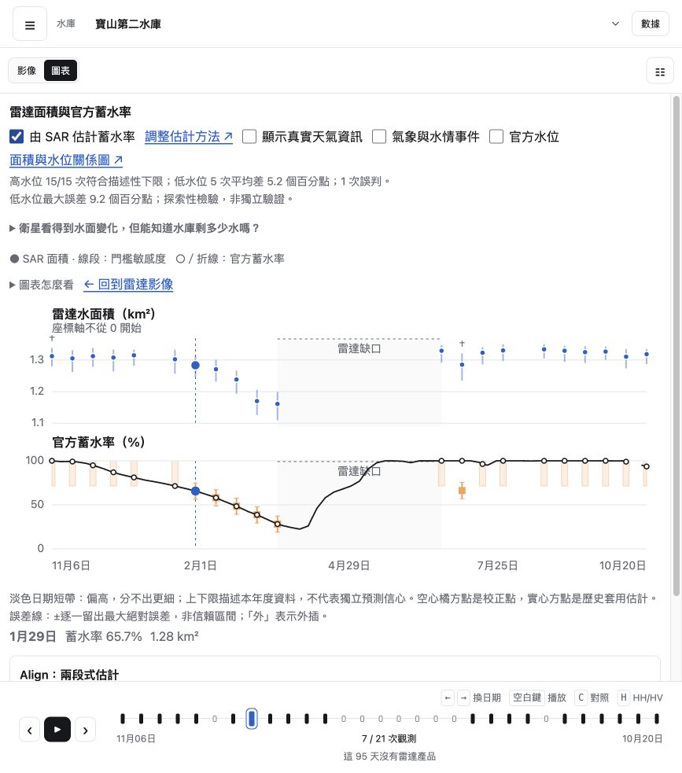
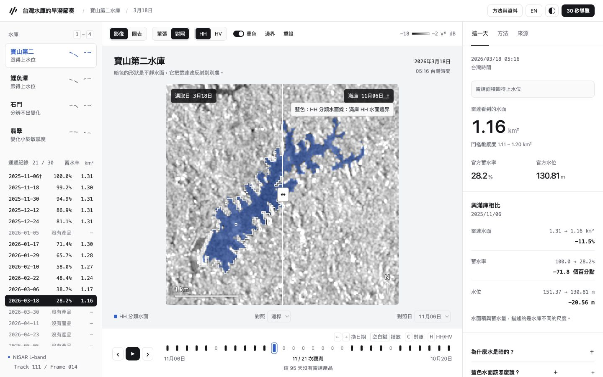

# Vercel 部署與安全查核

Production：[taiwan-water-pulse.vercel.app](https://taiwan-water-pulse.vercel.app)。目前為完成 CI 修復後重新發布的 ADV-10 兩段式蓄水率估計版本，狀態 **READY**。

## 最新發版：CI 修復（2026-11-15）

- 上線時間：**2026-11-15 02:37:38.065（Asia/Taipei）**；Vercel 為 READY。
- 部署來源：`b3bb0fe1568d3e44cadb0678f9e2a8e40ac420b6`，已 push 至 `main`。
- 修復天氣腳本的 17 項 Ruff 問題：UTC alias、匯入排序與行長；沿用原有檢查規則。AST 比對確認除等價的 UTC alias／import 正規化外，運算與字串內容一致。
- CI 現在執行 4 個既有天氣測試，連同 pipeline 原有測試共 65 個；115 個前端與 9 個部署防護測試、Ruff、Prettier、TypeScript、DEF-12 決定性重算及 offline 發布完整性檢查均通過。
- [GitHub CI #17](https://github.com/Mephisto-000/taiwan-water-pulse/actions/runs/43627551543) 的 `web`、`pipeline` 全數成功；歷史 #16 的失敗紀錄保留，不會因新提交而消失。
- 337 個網站產物、50,933,785 bytes，與前一 ADV-10 發布逐位元一致；Vercel 沿用既有內容雜湊，再以修復來源版本建立 production deployment。無套件、觀測資料、環境變數或存取保護變更。
- 337/337 個公開檔案匿名 HTTP 200、無 redirect，大小與 SHA-256 全數相符，快取檢查通過；6 個私人路徑皆 404。正式站確認影像、28.2% 官方紀錄、兩段式估計與圖表切換，所檢查流程 console error/warning 為 0。
- 來源候選快照、可達 Git 歷史、修復 commit 與部署產物 Gitleaks 均 0 findings；本機已知認證與私人身份比對 0 matches。提交使用公開 GitHub handle 與 noreply；未改寫歷史。
- 前一成功 production 為來源 `e33cf7a` 的 ADV-10 發布。後續純文件 commit 不改變線上產物。

證據：[manifest](review/ci-repair-deployment-manifest.json)、[HTTP 驗證](review/ci-repair-deployment-verification.json)、[CI 畫面](review/ci-repair-github.jpg)、[正式站畫面](review/ci-repair-production.jpg)。

## 最新發版：ADV-10

- 上線時間：**2026-11-14 23:44:00.989（Asia/Taipei）**。
- 部署來源：`e33cf7af5b78af1930f5b01964a5028742f03b5e`，已依使用者授權快轉合併到 `main` 並 push 至 `Mephisto-000/taiwan-water-pulse`。後續文件 commit 不改變部署產物。
- 發布範圍：337 個受檢靜態檔案，共 50,933,785 bytes；另附靜態 Vercel 設定。沿用專案、正式網域、Node 24.x、`web` Root Directory 及原有 Deployment Protection，未新增套件、環境變數或付費功能。
- Git integration 仍未連結；本次以已驗證的 `web/dist` 產物部署。上傳封裝保留 `web/` 路徑，符合既有 Root Directory；首次缺少該路徑的部署被 Vercel 拒絕，修正封裝後成功，未替換當時的正式版本。
- **337/337 個檔案匿名 HTTP 200、無重新導向，大小與 SHA-256 全數相符，`/assets/` 與 `/data/` 快取標頭符合設定。** `.env`、`token.md`、`.netrc`、`.git/config`、`README.md`、`pipeline/pyproject.toml` 均為 404。
- 正式網站確認兩段式為預設、DEF-12 分開呈現高水位與數字評估、可切換前 N 筆直線對照、B/C 級停用且能開啟原因說明，以及選取日的校正點標示。觀測視窗寬 867 px 無水平溢出，console error/warning 為 0；本部署最近 15 分鐘 error/fatal runtime logs 無紀錄（純靜態站）。
- 實作驗證為 115 個前端、9 個部署防護與 61 個 Python 測試通過。發布時重做正式建置、產物檢查、DEF-12 決定性重算、14 個新增計算測試與新增 Python 檔 Ruff，均通過；9 份科學輸入與既有來源逐位元一致。
- 全專案仍有 17 項既有 Ruff 問題，全部位於未修改的 `fetch_weather.py` 與 `test_fetch_weather.py`；不宣稱整體 GitHub CI 全綠。發布未重新下載科學或天氣資料。

完整證據：[檔案 manifest](review/adv10-deployment-manifest.json)、[線上驗證](review/adv10-deployment-verification.json)、[估計定義與評估](storage-prediction.md)。

如需回復，前一個成功 production 為來源 `b037f2bfd4985ee9651b57a46f9a8dc68fff3010` 的天氣與事件工作區版本；本次未執行 rollback。

## 歷史發版：方向 3 工作區

以下保留 **2026-11-14 17:34:36（Asia/Taipei）** 的原始紀錄；其中測試數量、manifest、驗證檔與前一版本描述均屬該次歷史發布，不代表目前 ADV-10。

### 當時 production

| 項目 | 實際值 |
| --- | --- |
| GitHub | `Mephisto-000/taiwan-water-pulse`；維持 private |
| Vercel project / scope | `taiwan-water-pulse` / `mephisto-000s-projects` |
| Target / frontend | `production`；Vite / React 純靜態產物 |
| 部署來源 commit | `5dbcfea5acbd45cee1e95abd621bcf64419a15fb` |
| 資料處理來源 commit | `ed5d561e6b35c8e717e4748bdb63573223e93520`；`code_dirty=false` |
| 科學方法 / SI metadata | `relative_power_v3` / declaration `1.2.0` |
| 發布順序 | 功能提交 → 從乾淨 commit 重建資料 → 資料提交 → push `main` → 建置與掃描 → Vercel |
| 發布範圍 | 332 個 `web/dist` 檔案，共 50,366,394 bytes；另附一份無秘密的靜態部署設定 |
| 本機 Node / npm | `24.15.0` / `11.12.1`；Vercel Node `24.x` |
| Root Directory | `web` |
| 建置時間 | 本機 Vite 129 ms（不含 TypeScript）；Vercel building 到 ready 約 3.6 秒 |
| Deployment Protection | `all_except_custom_domains`；production 匿名可達，未降低既有保護 |
| 自訂 Environment Variables | 查核為 0；未上傳 Earthdata 認證 |
| 費用設定 | 未升級、未啟用 trial、付費附加功能或監控；connector 未提供帳號 billing plan，未自行宣稱已確認 Hobby |

GitHub `main` 的部署來源版本先完成推送，再透過已連結的 Vercel plugin 上傳受檢產物。資料來源 commit 與部署 commit 不同，是為了從乾淨程式版本產生資料，再提交資料產物；不是未提交的程式變更。後續純部署紀錄 commit 不改變線上產物。

來源設定為 `web/vercel.json`：`npm ci` → `npm run build && npm run check:deploy` → `dist`。API 發布只傳送編譯產物，使用 `framework: null`、空白 install/build command、`outputDirectory: "."` 與相同快取標頭。未傳送 repository 根目錄；本機未安裝 Vercel CLI 或建立 token。

[部署 manifest](deployment-manifest.json)包含公開檔案的大小、SHA-1 與 SHA-256；[線上驗證](deployment-verification.json)記錄狀態、雜湊、快取與互動結果。內部 team/project/deployment ID 不寫入文件。

## 本次工作區與科學更新

- 桌機三欄呈現水庫／日期、影像／圖表與詳情分頁；手機保留底部時間軸。淺色與深色主題使用系統字型，未新增套件或外部字型請求。
- 時間軸由資料產生 30 個時段，包含 21 次真實觀測與 9 個缺產品時段。影像優先載入選取日與參考日，其餘 HH 延後載入，HV 按需載入。
- 顯示間距為 10 m（寶山第二、鯉魚潭、石門）或 20 m（翡翠）；四庫分類共用原生 30 m HH 方法。顯示範圍與分類設定分開。
- 新分級為寶山第二 A、鯉魚潭 A、石門 C、翡翠 B。石門保留影像，介面隱藏面積及分類疊色；各極化 QA 旗標保留於主要分析，另列排除旗標的敏感度結果。
- 方法分頁提供效應大小、滿庫重複性、門檻敏感度及寶山第二／鯉魚潭水量閉合。閉合使用官方水位，是物理合理性檢查，並非獨立驗證。
- 門檻試算與全年水體頻率保留在可展開的工具中，試算不改動發布數據；頻率圖等全部分析影格載入後才計算。

## 測試與線上驗證

- 65 個前端、9 個部署防護、47 個 Python 測試通過；TypeScript、正式建置、Prettier、Ruff 均通過。
- 真實匯出格網的面積一致性與資料發布條件仍由測試檢查；新增測試涵蓋分級、QA、閉合、顯示、時段、漸進載入及 C 級數值限制。
- **332 個公開檔案全部匿名 HTTP 200、無 redirect；SHA-256 全數與本機產物相符，快取標頭全部符合設定。**
- `/assets/` 為 `public, max-age=31536000, immutable`；`/data/` 為 `public, max-age=0, must-revalidate`。
- 線上確認 `relative_power_v3`、4 庫各 21 日期、資料來源 `ed5d561e`、`code_dirty=false`、SI declaration `1.2.0`。原始觀測與影像標示不是 SI-generated。
- `.env`、`token.md`、`.netrc`、`.git/config`、`README.md`、`pipeline/pyproject.toml` 均為 404。
- 本機已查核 1440×900、1280×720 與 375×667 iframe 行動版。前兩者無水平溢出；1280×720 影像區高約 361 px。行動版首屏可見影像且時間軸固定於底部。詳見[本機工作區驗證](review/workspace-validation.json)。
- 本機互動查核涵蓋日期與缺口、水庫、HH／HV 與 QA、中英切換保存 URL、中文導覽、對照邊界、深淺主題及門檻試算；乾淨重新載入後 browser errors 為 0。
- 正式網站 CUA 使用實際 production URL 的 1440×900 iframe 查核：中英文切換、HH／HV（HV −21 至 −6 dB）、方法分頁的 30 m／0.6 設定與 r／ρ 信賴區間、石門 C 級不顯示面積，以及一般播放的開始／推進／暫停均確認；console error／warning 為 0。
- 本 deployment 最近 15 分鐘 error／fatal runtime logs 無紀錄；此站為純靜態站。

本機視覺證據：[桌機淺色](review/workspace-desktop.jpg)、[桌機深色](review/workspace-dark.jpg)、[行動版](review/workspace-mobile.jpg)。正式網站截圖由本次 production 查核保存。

首屏 20 個必要檔案的 gzip body 合計估算為 **512,090 bytes**。這是依建置產物計算的壓縮大小，**不是實測 CDN 傳輸量、載入時間或 LCP**；未包括 HTTP 標頭、瀏覽器快取差異與後續背景預載。播放的影格 ready gate 已由程式修正，一般播放已實測；未進行弱網節流實測。完整公開資料總量不等於首次頁面傳輸量。尚未實測手機行動網路、跨瀏覽器矩陣或正式 WCAG 稽核。

## 敏感資訊與提交範圍

發布候選來源、`web/dist` 及可達 Git 歷史經 Gitleaks 掃描，均為 **0 findings**。499 個可提交檔案的候選快照另與本機兩筆已知認證、私人身分資料及 home path 做記憶體內 exact-value comparison，均為 **0 matches**；受檢部署產物也未命中。認證值未寫入報告、部署 metadata 或 Vercel 環境變數。部署後加入紀錄與截圖的 501 個可提交檔案也已再次查核，exact-value comparison 與 Gitleaks 均無命中。

私人 email 的歷史修正已完成。發布查核快照中可達的 **15 個 commit**，author 與 committer 全部使用 GitHub noreply email。現行文件使用專案相對路徑；後續提交維持公開 GitHub handle 與 noreply 身分，不改動全域 Git 身分設定。

`token.md` 已忽略，未包含於發布候選快照與部署產物。`.env.example` 認證欄位留空；`.gitignore` 排除秘密、原始快取與 `.vercel/`。查核範圍為目前可取得的 refs、候選來源與建置產物，不包含其他 repository、無法取得的 refs／外部副本、Actions artifacts/logs、私訊服務或圖片 OCR；掃描也不能保證辨識所有自訂秘密格式。

## 更新、Git integration 與回復

GitHub repo 維持 private。Vercel Git integration 尚未連結，**push 不會自動更新網站**；本次依使用者要求先 push，再透過 artifact API 部署。若日後啟用 Git integration，需由 owner 授權 Vercel App 存取此 repo，再保留 production branch `main`、Root Directory `web`、Vite、Node `24.x`。目前沒有宣稱 Git-trigger deployment 已驗證。

後續發版仍須建置、秘密掃描、上傳受檢產物，再匿名驗證正式網址與雜湊。資料重建使用 `water-pulse release --offline`；舊 `all --offline`／`export --offline` 只重建 Browse 備援。

前一個成功 production 為 **2026-11-14 15:43:57（Asia/Taipei）** 的校準影像 `relative_power_v3` 版本。必要時可在 Vercel 選取該已驗證 deployment 回復；該部署使用歷史整理前的來源 metadata，不以未核對的重寫後 Git SHA 代替。此文件不會自行觸發 rollback。
