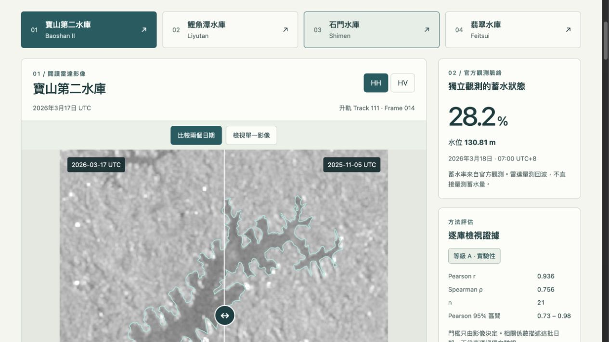

# Vercel 部署與安全查核

Production：[taiwan-water-pulse.vercel.app](https://taiwan-water-pulse.vercel.app)。校準影像與 relative-power v3 版本為 **READY**，於 2026-11-14 15:43:57（Asia/Taipei）上線。對外使用此 production 網域。

## 目前 production

| 項目 | 實際值 |
| --- | --- |
| GitHub | `Mephisto-000/taiwan-water-pulse`；維持 private |
| Vercel project / scope | `taiwan-water-pulse` / `mephisto-000s-projects` |
| Target / frontend | `production`；Vite / React 純靜態產物 |
| 部署來源 commit | `56159dd5a9f38fa554f1be853683cfcb311f2d9b` |
| 資料處理來源 commit | `9d332fd500e52a3a280df067a397e71802a1979b`；`code_dirty=false` |
| 發布順序 | 功能提交 → 從乾淨 commit 重建資料 → 資料提交 → push `main` → 建置與掃描 → Vercel |
| 發布範圍 | 331 個 `web/dist` 檔案，共 49,713,814 bytes；另附一份無秘密的靜態部署設定 |
| 本機 Node / npm | `24.15.0` / `11.12.1`；Vercel Node `24.x` |
| Root Directory | `web` |
| 建置時間 | 本機 Vite 125 ms（不含 TypeScript）；Vercel 靜態輸出 258 ms，building 到 ready 約 3.1 秒 |
| Deployment Protection | `all_except_custom_domains`；production 匿名可達，未降低既有保護 |
| 自訂 Environment Variables | 查核為 0；未上傳 Earthdata 認證 |
| 費用設定 | 未升級、未啟用 trial、付費附加功能或監控；connector 未提供帳號 billing plan，未自行宣稱已確認 Hobby |

GitHub 先成功推送 `9d332fd` 與 `56159dd`，再透過已連結的 Vercel plugin 上傳已檢查產物。資料來源 commit 與部署 commit 不同，是為了從乾淨程式版本產生資料，再提交產物；不是未提交的程式變更。後續純部署紀錄 commit 不改變線上產物。

來源設定為 `web/vercel.json`：`npm ci` → `npm run build && npm run check:deploy` → `dist`。API 發布只傳送編譯產物，使用 `framework: null`、空白 install/build command、`outputDirectory: "."` 與相同快取標頭。未傳送 repository 根目錄。Vercel 平台使用 CLI `65.14.0`；本機未安裝 CLI 或建立 token。

[部署 manifest](deployment-manifest.json)包含每個公開檔案的大小、SHA-1 與 SHA-256；[線上驗證](deployment-verification.json)記錄實際狀態、雜湊、快取與互動結果。內部 team/project/deployment ID 不寫入文件。

## 測試與線上驗證

- 40 個前端、9 個部署防護、34 個 Python 測試通過；TypeScript、正式建置、Prettier、Ruff 均通過。
- 4 庫 × 21 期分析面積與 50%／70% 敏感度由瀏覽器算法重算，84 筆均與 Python 相符至小數點後 9 位。
- 331 個公開檔案全部匿名 HTTP 200，SHA-256 全數與本機相符，未轉向登入頁。
- `/assets/` 為 `public, max-age=31536000, immutable`；`/data/` 為 `public, max-age=0, must-revalidate`。
- 匿名瀏覽器核對中英文、寶山第二／鯉魚潭／石門切換、HH／HV、比較滑桿鍵盤 50→51、28.2%／34.4% 官方紀錄與石門低信心提示；所檢查流程 console error / warning 均為 0。
- 線上方法為 `relative_power_v3`、4 庫 21 日期、資料來源 commit `9d332fd5`、SI declaration `1.1.0`。原始觀測與影像標示不是 SI-generated。
- `.env`、`token.md`、`.netrc`、`.git/config`、`README.md`、`pipeline/pyproject.toml` 均為 404。
- 本 deployment 最近 15 分鐘 error/fatal runtime logs 無紀錄；此站為純靜態站。
- 本機驗證 1440 px 桌面及 375 px iframe 行動版無文件水平溢出，英文五幕導覽可完成並自動停止。尚未實測手機行動網路、跨瀏覽器矩陣或正式 WCAG 稽核。

新版移除 MapLibre；JavaScript 約 298 KB、gzip 約 95 KB，不再有舊版大型 MapLibre chunk。校準影像按水庫載入，完整公開資料總量不等於首次頁面傳輸量。

## 敏感資訊與提交範圍

本次新增提交與全部 `web/dist` 經 Gitleaks `8.30.1` 完整遮蔽掃描，0 findings。全部 476 個可提交檔案（部署紀錄截圖加入前）及 331 個公開檔案另與本機已知認證、私人姓名、email 和 home path 做記憶體內 exact-value comparison，0 matches。認證值未寫入報告、部署 metadata 或 Vercel 環境變數。最終部署文件提交另重跑相同檢查。

`token.md` 存在但已忽略；不在 staged snapshot 或任一歷史 tree。`.env.example` 認證欄位留空；`.gitignore` 排除秘密、原始快取與 `.vercel/`。新提交採公開 GitHub handle 及 GitHub noreply email，只作用於這次 commit，未修改全域身份設定。

**既有歷史限制：** 初次部署前 3 個 commit 的 author/committer 含非 GitHub noreply email，舊文件也曾含本機使用者絕對路徑。本次沒有改寫歷史；現行文件使用專案相對路徑。初次完整掃描未發現已提交的帳號密碼、token、私鑰或聊天紀錄。本次也重新掃描既有歷史及新增提交，秘密掃描 0 findings。掃描不涵蓋其他 repository、私訊服務、無法取得的 refs、Actions artifacts/logs 或圖片 OCR，也不能保證識別所有自訂秘密格式。

## 更新、Git integration 與回復

GitHub repo 維持 private。Vercel Git integration 尚未連結，**push 不會自動更新網站**；本次依使用者要求先 push，再透過 artifact API 部署。若日後啟用 Git integration，需由 owner 授權 Vercel App 存取此 repo，再保留 production branch `main`、Root Directory `web`、Vite、Node `24.x`。目前沒有宣稱 Git-trigger deployment 已驗證。

後續發版仍須建置、秘密掃描、上傳受檢產物，再匿名驗證正式網址與雜湊。資料重建使用 `water-pulse release --offline`；舊 `all --offline`／`export --offline` 只重建 Browse 備援。

前一個成功 production 為 2026-11-14 12:59:45 的 SI Browse 版本，來源 `2a879bbca54dc55f0a257a1a12dd0284b1289bad`。必要時可由 Vercel rollback 恢復，或重新發布相應 Git 版本的已驗證產物。此文件不會自行觸發 rollback。
