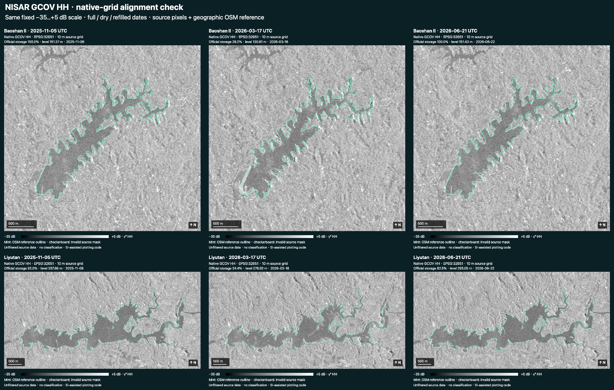

# Native GCOV HH alignment quickviews

These six diagnostic figures use actual cached `HHHH` linear-power observations for Baoshan II and Liyutan on 2025-11-05, 2026-03-17 and 2026-06-21 (UTC). They do not use browse brightness or a classified water mask.



## What is shown

- Source-native EPSG:32651 coordinates and 10 m source grid spacing, with north up. All three source coordinate arrays are identical within each reservoir.
- Direct `10 × log10(HHHH)` with the same fixed −35 to +5 dB display mapping across all six views. No smoothing, reprojection, fitted image offset, histogram equalization or date-specific contrast stretch is applied.
- The mint outline is the unchanged OpenStreetMap reference polygon, transformed from WGS84 to the actual source UTM coordinates and rasterized at source-pixel centres. It is not a surveyed shoreline or independent water-classification truth.
- Source mask 0/255 and nonpositive/nonfinite powers are invalid; these use a checkerboard instead of dark gray. Official labels are copied from the unchanged records for the following Taiwan-local date.
- Text and plotting code are SI-assisted; the satellite observations are not SI-generated. These figures contain no agency logos or branding artwork.

## Visual inspection

The 2025-11-05 and 2026-06-21 Baoshan II outlines broadly follow the dark branched reservoir feature. Liyutan's long east–west dark feature and branches also follow the geographic outline. No obvious whole-image horizontal/vertical reversal or large translation is visible in these six source-native views. This is a qualitative check, not a quantified registration-accuracy claim.

The March Baoshan II image shows brighter near-shore strips in parts of the south-western basin and some branches; the Liyutan image shows narrower dark portions and brighter patches in parts of its central/eastern branches. Much of the polygon interior remains dark in all dates. Visual appearance alone therefore does not determine a valid water-area threshold or explain changes in correlation with grid spacing. Coarse-scale and full-resolution results must be reported separately; these figures do not establish which estimator is more accurate.

## Individual figures

| Reservoir | 2025-11-05 UTC | 2026-03-17 UTC | 2026-06-21 UTC |
| --- | --- | --- | --- |
| Baoshan II | [Full-storage view](baoshan2-2025-11-05-gcov-hh.png) | [Low-storage view](baoshan2-2026-03-17-gcov-hh.png) | [Refilled view](baoshan2-2026-06-21-gcov-hh.png) |
| Liyutan | [Initial view](liyutan-2025-11-05-gcov-hh.png) | [Low-storage view](liyutan-2026-03-17-gcov-hh.png) | [Post-gap view](liyutan-2026-06-21-gcov-hh.png) |

Input hashes, grid coordinates, official records and output hashes are in [gcov-quickviews.json](gcov-quickviews.json). Reproduce on macOS, from the repository root with the existing calibrated caches and pipeline environment:

```bash
uv run --project pipeline python docs/review/generate-gcov-quickviews.py
```

The script uses the existing NumPy, rasterio and SciPy dependencies. `/usr/bin/swift` and system AppKit add labels and assemble the figures; no package is installed. Intermediate files and the Swift module cache are kept in the system temporary directory. The numeric visualization is reproducible, but PNG bytes may vary with the macOS font/rendering version.
